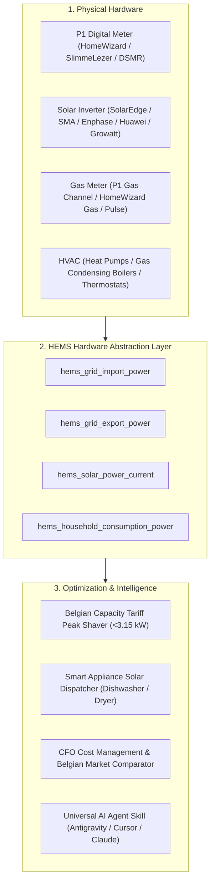

# ⚡ Open HEMS — Autonomous Home Energy Management System

[](LICENSE)
[](https://www.home-assistant.io/)
[](skills/hems-agent/SKILL.md)
[](https://hems-cfo-dashboard.vercel.app/advies)

> **Autonomous, economic, and grid-aware Home Energy Management System (HEMS) for Home Assistant.**  
> Built for the Belgian digital meter, Fluvius capacity tariff peak-shaving, dynamic Belpex/spot tariffs, and solar surplus dispatching.

---

### 👵 Live Senior & Family Energy Advisor (WCAG AAA)
Looking for an ultra-simple, accessible energy switch calculator for seniors, parents, or family members without any technical jargon?
👉 **Test the live public advisor:** **[hems-cfo-dashboard.vercel.app/advies](https://hems-cfo-dashboard.vercel.app/advies)**  
*(Also accessible via `/eenvoudig`). Features extra-large typography, 1-click WhatsApp family sharing, and 100% independent tariff calculations.*

---

## 🏛️ Architecture & Hardware Abstraction

Open HEMS decouples your physical meters from the optimization algorithms via a **Hardware Abstraction Layer (HAL)**:



---

## 📦 What's Included?

1. **`packages/hems/00_hems_hardware_abstraction.yaml`**  
   Standardizes grid import/export, solar, and consumption entities into clean, normalized sensors.
2. **`packages/hems/10_hems_capacity_tariff.yaml`**  
   Tracks 15-minute rolling average peak power to prevent costly Fluvius capacity tariff surcharges.
3. **`packages/hems/20_hems_smart_appliances.yaml`**  
   Intelligently delays heavy appliances (dishwasher, washing machine, heat pump) to solar production valleys or low-tariff hours.
4. **`skills/hems-agent/SKILL.md`**  
   Universal agent skill that allows any AI coding assistant to auto-discover your hardware and manage your energy setup.
5. **`scripts/discover_entities.py`**  
   Automated Python discovery tool that queries your Home Assistant REST API and maps your local sensors.

---

## 🚀 Quick Start (in 3 Minutes)

### Step 1: Copy Packages to Home Assistant
Copy the `packages/hems/` directory into your Home Assistant `/config/packages/` folder. Ensure your `configuration.yaml` includes packages:

```yaml
homeassistant:
  packages: !include_dir_named packages
```

### Step 2: Auto-Discover Your Entities
Run the discovery script to detect your local sensors:
```bash
export HA_URL="http://homeassistant.local:8123"
export HA_TOKEN="your_long_lived_access_token_here"
python3 scripts/discover_entities.py
```

### Step 3: Reload Home Assistant Core
Reload your template entities via **Developer Tools > YAML > Reload Template Entities** or run:
```bash
ha core reload
```

---

## 🤖 AI Agent-Driven Smart Home Management (Google Antigravity & Beyond)

Managing a modern smart home with dynamic energy prices, capacity tariffs, solar forecasts, and HVAC thermal inertia is **too complex for manual YAML configuration**. 

**Open HEMS is built natively for AI Pair-Programming with Google Antigravity (AGY)** and modern agentic coding environments (Claude Code, Cursor, Windsurf, Copilot Workspace). Instead of writing template sensors by hand, you delegate the heavy lifting to your AI coding agent.

```
       ┌────────────────────────────────────────────────────────┐
       │                Your High-Level Goal                    │
       │  "Optimize my home for Fluvius capacity tariff and     │
       │   switch my heat pumps to solar surplus dispatching."  │
       └───────────────────────────┬────────────────────────────┘
                                   │
                                   ▼
       ┌────────────────────────────────────────────────────────┐
       │               Google Antigravity Agent                 │
       │   • Reads `.agents/skills/hems-agent/SKILL.md`         │
       │   • Auto-discovers physical meters via HA REST API     │
       │   • Maps entities to the Hardware Abstraction Layer    │
       │   • Configures automations & runs `ha core check`      │
       └───────────────────────────┬────────────────────────────┘
                                   │
                                   ▼
       ┌────────────────────────────────────────────────────────┐
       │                 Home Assistant Core                    │
       │     Active, Self-Balancing Economic Energy Engine      │
       └────────────────────────────────────────────────────────┘
```

### 1. How to use with Google Antigravity (AGY)
The repository includes a ready-to-use skill in [`.agents/skills/hems-agent/SKILL.md`](.agents/skills/hems-agent/SKILL.md).

1. **Open your Home Assistant workspace** in Google Antigravity.
2. **Clone or add Open HEMS** to your workspace.
3. **Prompt Antigravity**:
   ```text
   Read the hems-agent skill and inspect my Home Assistant setup.
   Connect my P1 meter and solar inverter to the HEMS Hardware Abstraction Layer.
   ```
4. **Use Slash Commands for Deep Optimization**:
   * **`/plan`**: *"Draft an economic comparison of my current energy contract against Belgian fixed vs. variable market deals."*
   * **`/goal`**: *"Autonomously audit my white goods scheduling, eliminate morning peak-hour triggers, and verify condensing boiler efficiency."*

---

### 2. Example Prompts for Any AI Coding Assistant
Whether you use **Google Antigravity**, **Claude Code**, or **Cursor**, you can copy-paste these turnkey instructions:

* **Hardware Discovery & Setup:**
  > *"Inspect my `configuration.yaml` and entity states. Map my physical smart meter (`sensor.p1_*`) and solar inverter (`sensor.solaredge_*` / `sensor.huawei_*`) to `packages/hems/00_hems_hardware_abstraction.yaml`."*

* **Belgian Capacity Tariff Guard:**
  > *"Analyze my historical peak power demand in Home Assistant. Set up a warning threshold at 3.15 kW and write an automation to pause heavy loads when grid power approaches this limit."*

* **HVAC Thermal Inertia Tuning:**
  > *"Review my heating topology. Enforce a minimum comfort baseline of 20.0°C on hydronic floor heating to prevent thermal mass loss, while utilizing rapid heat pumps for midday solar pre-heating."*

---

## 📄 License & Community

Released under the **MIT License**. Maintained with ❤️ by the **[HEMS Lab](https://github.com/hems-lab)** community.

