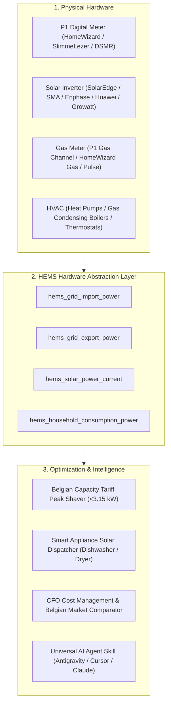

# ⚡ Open HEMS — Autonomous Home Energy Management System

[](LICENSE)
[](https://www.home-assistant.io/)
[](skills/hems-agent/SKILL.md)
[](https://hems-cfo-dashboard.vercel.app/advies)

> **Autonomous, economic, and grid-aware Home Energy Management System (HEMS) for Home Assistant.**  
> Built for the Belgian digital meter, Fluvius capacity tariff peak-shaving, dynamic Belpex/spot tariffs, and solar surplus dispatching.

---

### 👵 Live Senior & Family Energy Advisor (WCAG AAA)
Looking for an ultra-simple, accessible energy switch calculator for seniors, parents, or family members without any technical jargon?
👉 **Test the live public advisor:** **[hems-cfo-dashboard.vercel.app/advies](https://hems-cfo-dashboard.vercel.app/advies)**  
*(Also accessible via `/eenvoudig`). Features extra-large typography, 1-click WhatsApp family sharing, and 100% independent tariff calculations.*

---

## 🏛️ Architecture & Hardware Abstraction

Open HEMS decouples your physical meters from the optimization algorithms via a **Hardware Abstraction Layer (HAL)**:



---

## 📦 What's Included?

1. **`packages/hems/00_hems_hardware_abstraction.yaml`**  
   Standardizes grid import/export, solar, and consumption entities into clean, normalized sensors.
2. **`packages/hems/10_hems_capacity_tariff.yaml`**  
   Tracks 15-minute rolling average peak power to prevent costly Fluvius capacity tariff surcharges.
3. **`packages/hems/20_hems_smart_appliances.yaml`**  
   Intelligently delays heavy appliances (dishwasher, washing machine, heat pump) to solar production valleys or low-tariff hours.
4. **`skills/hems-agent/SKILL.md`**  
   Universal agent skill that allows any AI coding assistant to auto-discover your hardware and manage your energy setup.
5. **`scripts/discover_entities.py`**  
   Automated Python discovery tool that queries your Home Assistant REST API and maps your local sensors.

---

## 🚀 Quick Start (in 3 Minutes)

### Step 1: Copy Packages to Home Assistant
Copy the `packages/hems/` directory into your Home Assistant `/config/packages/` folder. Ensure your `configuration.yaml` includes packages:

```yaml
homeassistant:
  packages: !include_dir_named packages
```

### Step 2: Auto-Discover Your Entities
Run the discovery script to detect your local sensors:
```bash
export HA_URL="http://homeassistant.local:8123"
export HA_TOKEN="your_long_lived_access_token_here"
python3 scripts/discover_entities.py
```

### Step 3: Reload Home Assistant Core
Reload your template entities via **Developer Tools > YAML > Reload Template Entities** or run:
```bash
ha core reload
```

---

## 🤖 Universal AI Agent Skill

If you use an AI coding assistant (such as **Google Antigravity**, **Cursor**, **Claude Code**, or **GitHub Copilot**), simply provide it with our skill file:

```markdown
Read skills/hems-agent/SKILL.md to inspect my Home Assistant entities and optimize my HEMS setup.
```

The agent will automatically discover your meter entities, calculate your optimal capacity tariff threshold, and configure your automations.

---

## 📄 License & Community

Released under the **MIT License**. Maintained with ❤️ by the **[HEMS Lab](https://github.com/hems-lab)** community.
